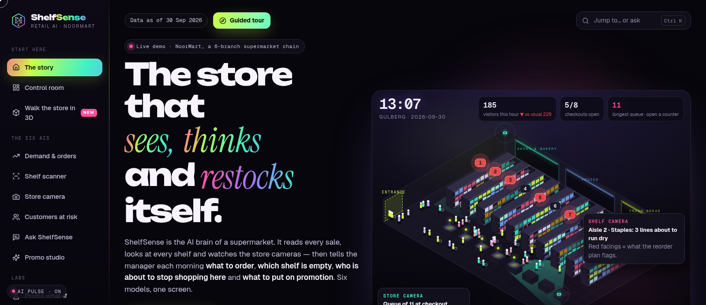
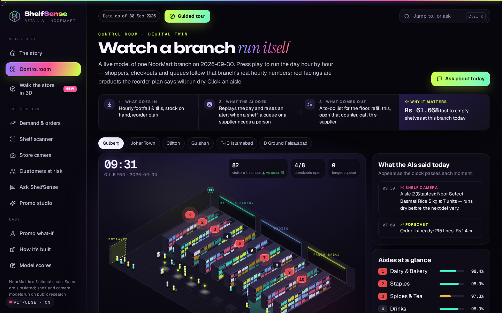
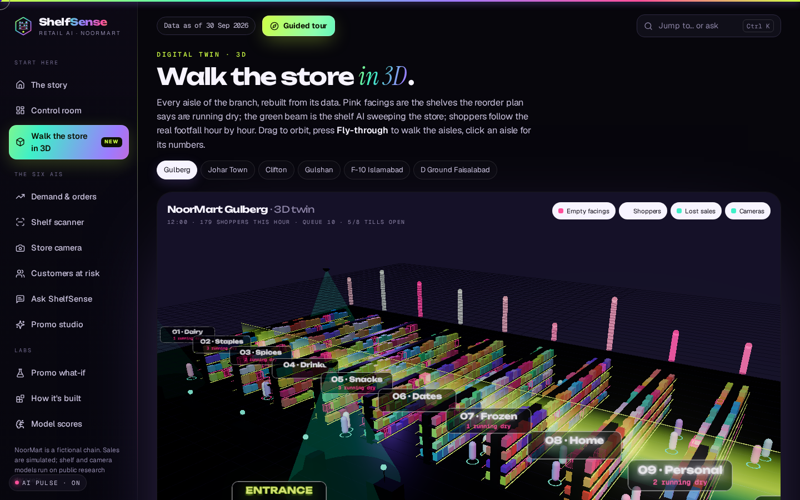
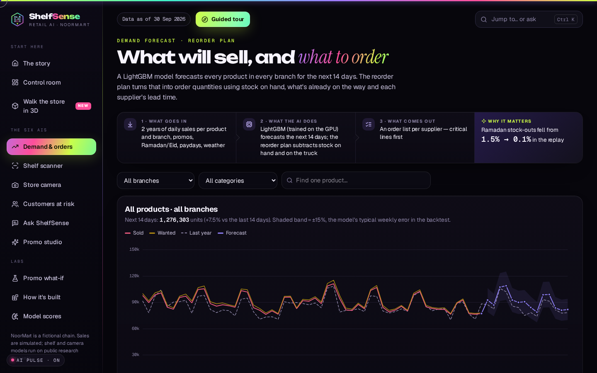
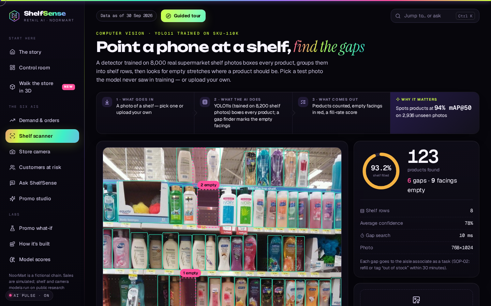
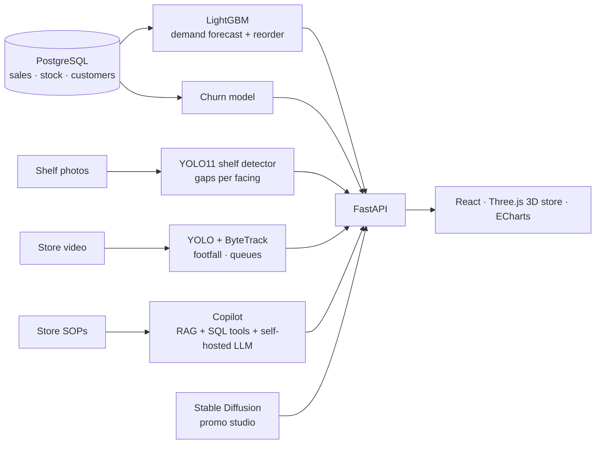

# ShelfSense

**Retail AI & computer vision**

The AI brain of a six-branch supermarket chain. ShelfSense reads every sale, looks at every shelf and watches the store cameras, then tells the manager each morning what to order, which shelf is empty, which customers are about to stop shopping and what to put on promotion. Six models on one screen, with a 3D walk-through of the store.

[**Open the live demo**](https://shelfsense.twinstackstudio.com) · [**Work with TwinStack Studio**](https://twinstackstudio.com/contact)

> **Note:** NoorMart is fictional: its sales, stock, customers and documents are simulated, because a real chain's data is private. The shelf photos (SKU-110K) and store videos (CAVIAR) are public research datasets, and the vision models are scored on them.

## What it does

- Two years of simulated sales, stock, deliveries and waste for 502 products in 24 categories, including Ramadan and Eid, paydays, summer heat and late suppliers, in a PostgreSQL star schema
- A LightGBM demand forecast for every product and branch with a 14-day reorder plan; on months it never saw, weekly error falls from 17.3% to 14.8%
- A churn model (AUC 0.90) that finds 70% of the members who will stop shopping in the riskiest 10%, with the reasons for each one
- Shelf vision: YOLO11s trained on 11,743 real shelf photos, 94.1% mAP@50 on 2,936 unseen photos, plus a gap finder for empty shelf space
- Store camera: people detection and tracking across 52 shopping-centre videos for footfall, heatmaps and checkout queues
- Ask ShelfSense: questions answered from 12 fixed SQL functions and 16 store documents, and a reply is dropped if it adds a number the data does not contain
- A promo lab that measures past discounts per category, and a studio that writes product copy and paints posters with Stable Diffusion

## Screenshots

| Control room | 3D store |
| --- | --- |
|  |  |

| Demand | Shelf gaps |
| --- | --- |
|  |  |

## Technology

| Layer | Stack |
| --- | --- |
| AI models | LightGBM, YOLO11, ByteTrack, Stable Diffusion |
| Language AI | Self-hosted LLM, RAG, bge-small embeddings |
| Backend | Python, FastAPI, PostgreSQL, PyTorch |
| Frontend | React, Three.js, ECharts, Tailwind CSS |

## Architecture

## Source code

This is the public showcase. The source code is kept in a private repository. Try the live demo above, and [contact TwinStack Studio](https://twinstackstudio.com/contact) for a walkthrough or a similar project.

## Built by TwinStack Studio

TwinStack Studio builds full-stack websites, web applications, mobile apps,
dashboards, portals, automation, and AI-powered products.

[GitHub](https://github.com/twinstack-studio) ·
[Website](https://twinstackstudio.com) ·
[Email](mailto:hello@twinstackstudio.com)

© 2026 TwinStack Studio. All rights reserved. See [LICENSE](./LICENSE).
